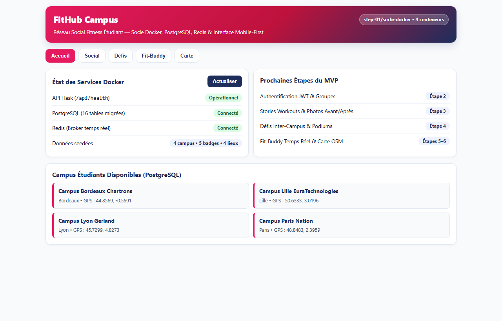
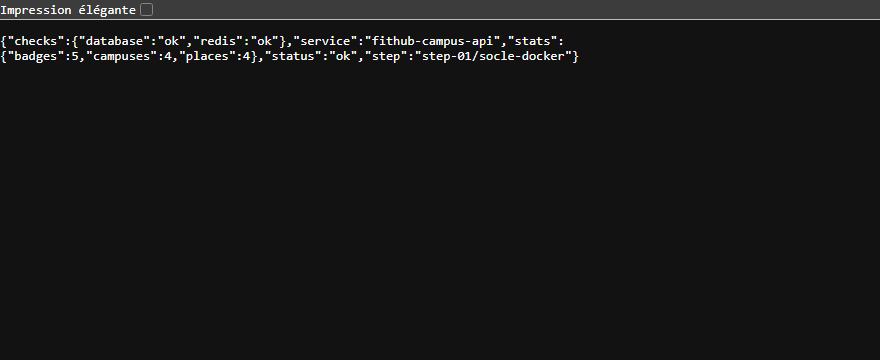
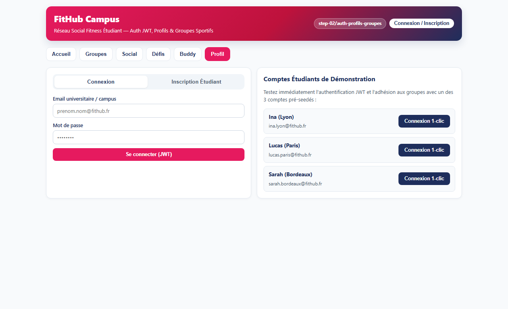
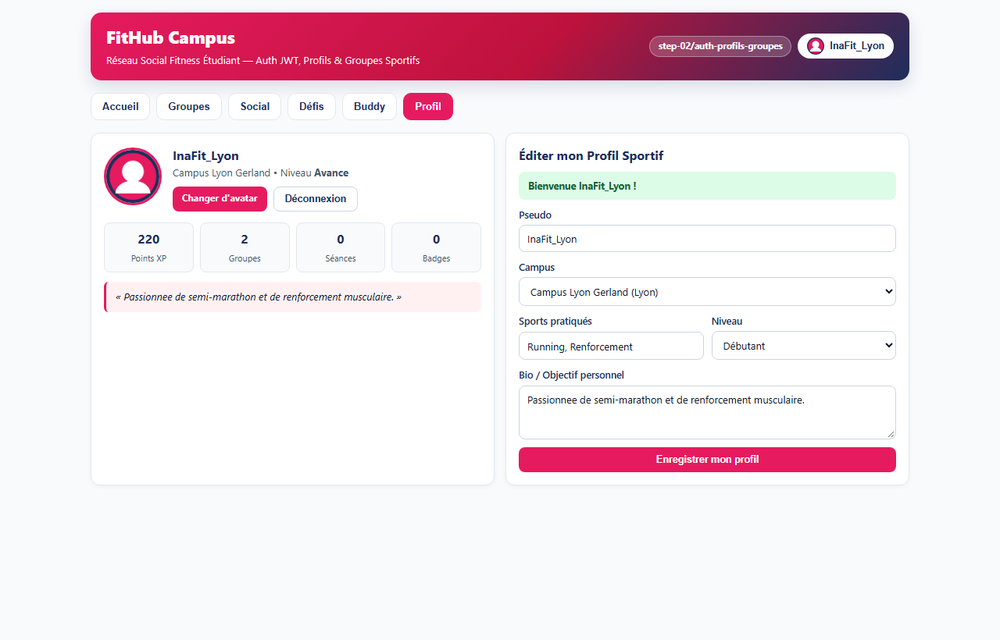

# FitHub Campus — Album des Captures d'Écran par Étape

Ce document conserve, **étape par étape**, les captures d'écran réelles validant chaque incrément du projet **FitHub Campus** avant le passage à l'étape suivante.

- **Dépôt GitHub** : https://github.com/frank-kenfack/FitHub-Campus
- **Journal d'avancement** : [AVANCEMENT.md](./AVANCEMENT.md)
- **Tableau de bord interactif** : [docs/SUIVI_ETAPES.html](./docs/SUIVI_ETAPES.html)
- **Règle de mise à jour** : à chaque nouvelle branche `step-XX/...`, les captures de l'étape sont enregistrées dans `docs/screenshots/step-XX/` et ajoutées dans ce fichier avant validation.

---

## Sommaire des Étapes

1. [Étape 1 — `step-01/socle-docker` (Socle Git, PostgreSQL, Stack Docker 4 conteneurs & UI Mobile-First)](#étape-1--step-01socle-docker) ✅
2. [Étape 2 — `step-02/auth-profils-groupes` (Authentification JWT, Profils & Groupes Sportifs)](#étape-2--step-02auth-profils-groupes) ✅
3. [Étape 3 — `step-03/social-fitness` (Stories Workouts, Photos Avant/Après & Interactions)](#étape-3--step-03social-fitness) ⏳
4. [Étape 4 — `step-04/defis-classements` (Défis Inter-Campus & Leaderboards)](#étape-4--step-04defis-classements) ⏳
5. [Étape 5 — `step-05/fitbuddy-realtime` (Matching Fit-Buddy & Temps Réel WebSockets)](#étape-5--step-05fitbuddy-realtime) ⏳
6. [Étape 6 — `step-06/geoloc-gamification` (Carte Leaflet/OSM, Événements & Badges)](#étape-6--step-06geoloc-gamification) ⏳
7. [Étape 7 — `step-07/cicd-qualite-docs` (Pipelines CI/CD GitLab/GitHub, Scripts & Recette)](#étape-7--step-07cicd-qualite-docs) ⏳
8. [Étape 8 — `step-08/kubernetes-bonus` (Orchestration Kubernetes +20 % & Démo Jury)](#étape-8--step-08kubernetes-bonus) ⏳

---

## Étape 1 — `step-01/socle-docker`

- **Statut** : ✅ Validée par les tests (`ruff` OK • `pytest` 5/5 • 4 conteneurs `healthy` • persistance PostgreSQL vérifiée)
- **Branche GitHub** : [`step-01/socle-docker`](https://github.com/frank-kenfack/FitHub-Campus/tree/step-01/socle-docker)
- **Services actifs** : `fithub-frontend` (`:8080`), `fithub-backend` (`:5000`), `fithub-db` (PostgreSQL 16), `fithub-redis` (Redis 7)

### 1.1 Vue Desktop de l'application (`http://localhost:8080/`)
Affichage en direct de l'état de santé des conteneurs (`Opérationnel`, `PostgreSQL Connecté`, `Redis Connecté`), des compteurs seedés (`4 campus • 5 badges • 4 lieux`) et de la liste des campus étudiants chargés depuis PostgreSQL.

---

### 1.2 Vue Responsive Mobile-First (Navigation basse à 5 onglets)
Adaptation mobile avec empilement vertical des cartes et barre de navigation fixe en bas d'écran (`Accueil`, `Social`, `Défis`, `Fit-Buddy`, `Carte`).

---

### 1.3 Endpoint de santé `/api/health` servi via le reverse proxy Nginx
Vérification JSON directe prouvant la connectivité entre Nginx (`frontend`), Gunicorn/Flask (`backend`), PostgreSQL (`db`) et Redis (`redis`).

---

### 1.4 Tableau de bord d'avancement & Journal des tests (`docs/SUIVI_ETAPES.html`)
Synthèse visuelle de l'architecture à 4 conteneurs, des livrables et des résultats d'exécution de `docker compose ps`, `ruff` et `pytest`.

---

## Étape 2 — `step-02/auth-profils-groupes`

- **Statut** : ✅ Validée par les tests (`ruff` OK • `pytest` **14/14** sans warning • upload & persistance d'avatar sur `uploads_data` vérifiés après redémarrage conteneur)
- **Branche GitHub** : [`step-02/auth-profils-groupes`](https://github.com/frank-kenfack/FitHub-Campus/tree/step-02/auth-profils-groupes)
- **Fonctionnalités couvertes** : Inscription/Connexion JWT (`bcrypt`), édition de profil + statistiques personnelles, upload d'avatar redimensionné via Pillow et servi par Nginx, CRUD groupes sportifs + filtres + adhésion/désinscription + liste des membres.

### 2.1 Écran Connexion / Inscription JWT & Comptes de démonstration
Formulaire d'authentification étudiante (bascule Connexion / Inscription) accompagné des 3 comptes étudiants pré-seedés pour tester immédiatement les parcours.

---

### 2.2 Profil Sportif connecté (`InaFit_Lyon`) & Avatar persistant
Vue connectée affichant l'avatar stocké sur le volume persistant `/uploads/avatars/...`, les compteurs personnels (`220 Points XP`, `2 Groupes`, `Séances`, `Badges`) et le formulaire d'édition du profil.

---

### 2.3 Groupes Sportifs Inter-Campus, Filtres & Liste des Membres
Exploration des groupes par campus/discipline/mot-clé, boutons d'adhésion (`Rejoindre` / `Quitter`), contrôle créateur (`Suppr.`) et tiroir des membres déplié sur *Lyon Running Rhone*.

---

### 2.4 Tableau de bord d'avancement mis à jour (25 % — 14/14 Pytest)
Synthèse visuelle de l'Étape 2 validée et trace d'exécution des 14 tests automatisés (non-régression Étape 1 incluse).

---

## Étape 3 — `step-03/social-fitness`

> ⏳ *Captures à ajouter lors de la réalisation de l'Étape 3 dans `docs/screenshots/step-03/` (fil de stories workouts, comparateur Avant/Après, likes et commentaires).*

---

## Étape 4 — `step-04/defis-classements`

> ⏳ *Captures à ajouter lors de la réalisation de l'Étape 4 dans `docs/screenshots/step-04/` (création/inscription aux défis inter-campus, soumission de performances, podiums et classements).*

---

## Étape 5 — `step-05/fitbuddy-realtime`

> ⏳ *Captures à ajouter lors de la réalisation de l'Étape 5 dans `docs/screenshots/step-05/` (matching Fit-Buddy, encouragements mutuels en direct via WebSockets entre deux sessions, compteur de streak).*

---

## Étape 6 — `step-06/geoloc-gamification`

> ⏳ *Captures à ajouter lors de la réalisation de l'Étape 6 dans `docs/screenshots/step-06/` (carte interactive Leaflet/OpenStreetMap, événements géolocalisés + RSVP, déblocage automatique de badges et import d'activités).*

---

## Étape 7 — `step-07/cicd-qualite-docs`

> ⏳ *Captures à ajouter lors de la réalisation de l'Étape 7 dans `docs/screenshots/step-07/` (exécution des pipelines CI/CD, rapport de tests E2E et benchmark de performance `< 300 ms`).*

---

## Étape 8 — `step-08/kubernetes-bonus`

> ⏳ *Captures à ajouter lors de la réalisation de l'Étape 8 dans `docs/screenshots/step-08/` (état des pods/services/PVC/Ingress Kubernetes pour le bonus +20 % et parcours final de démo jury).*
