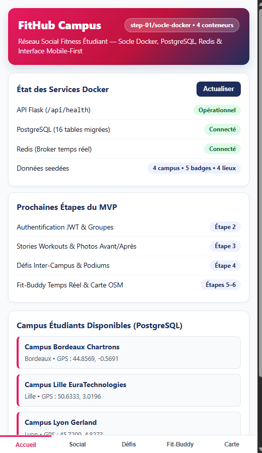
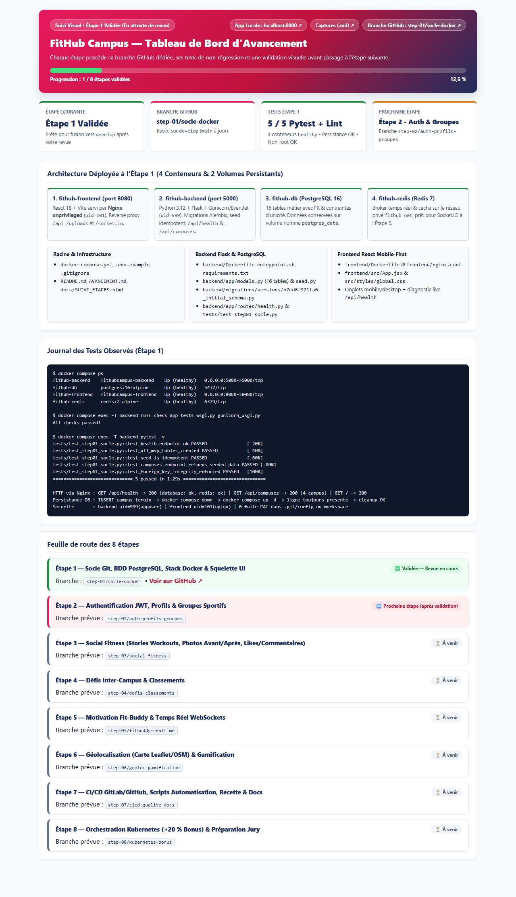
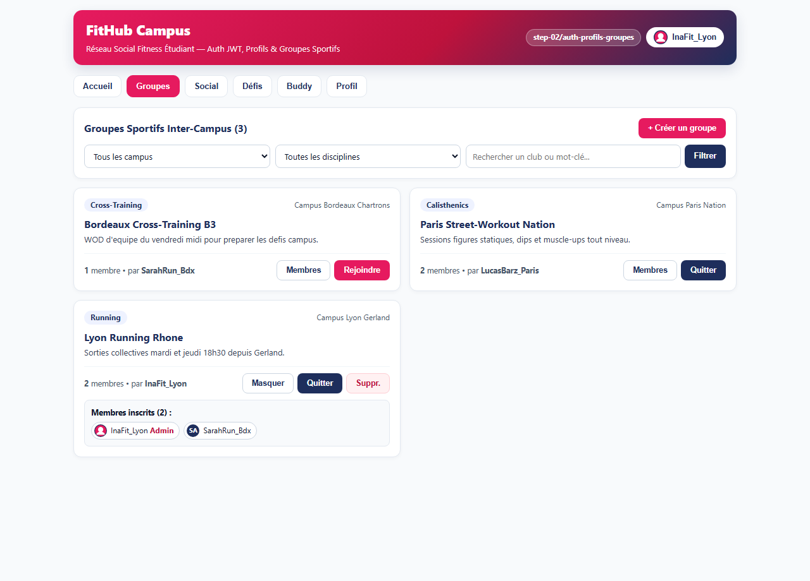
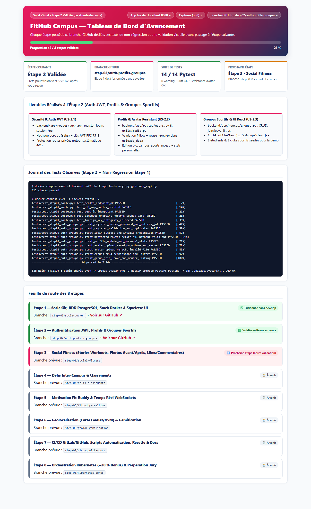
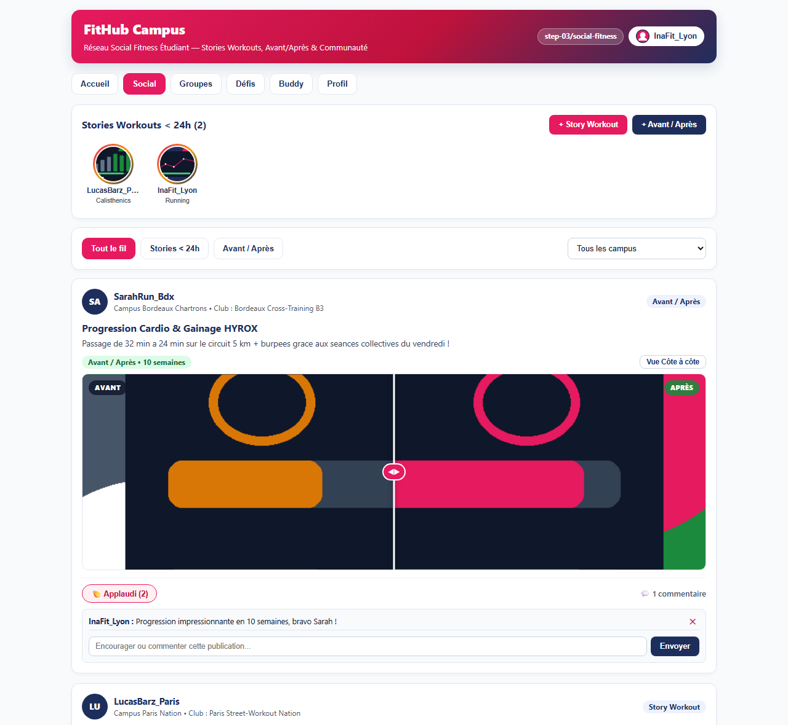
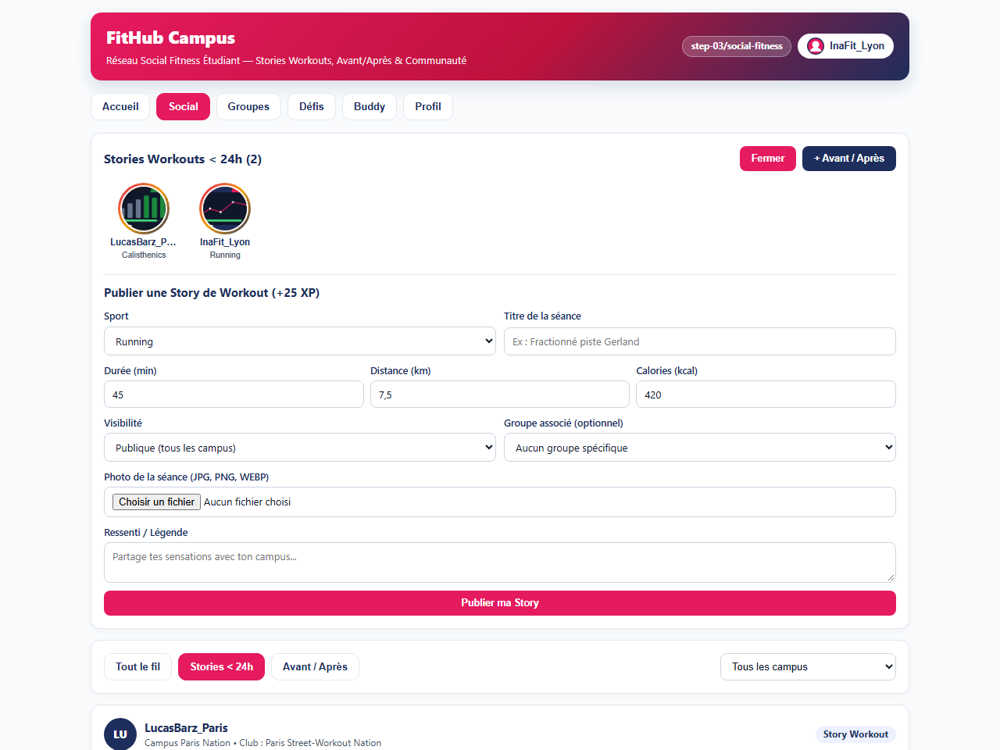
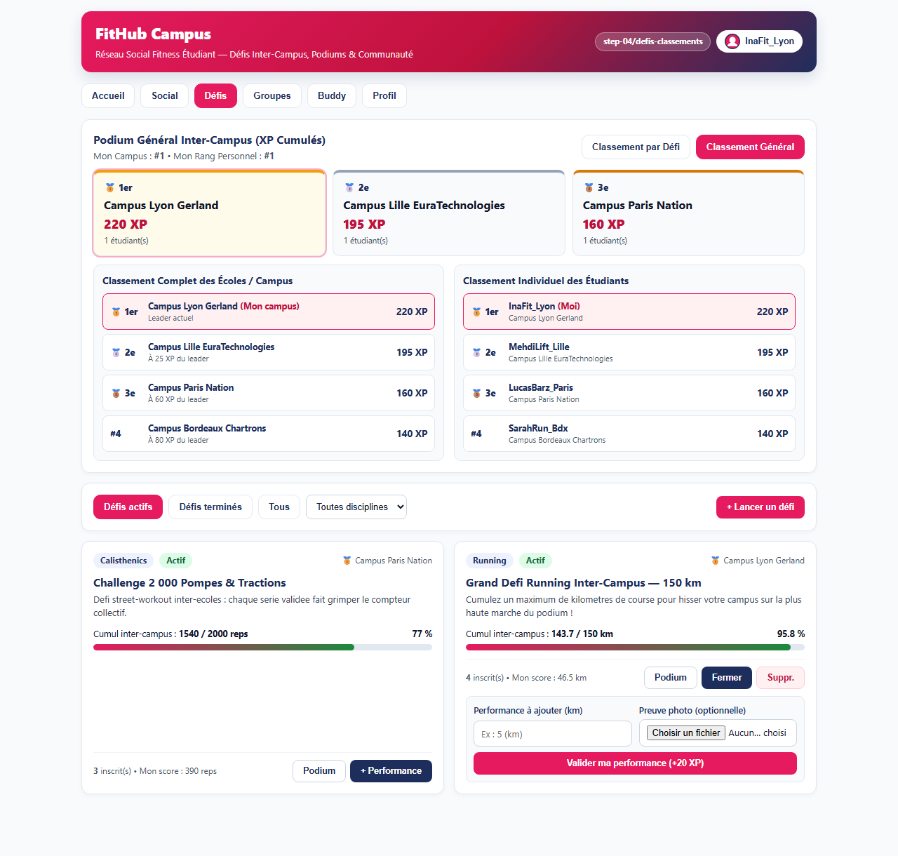
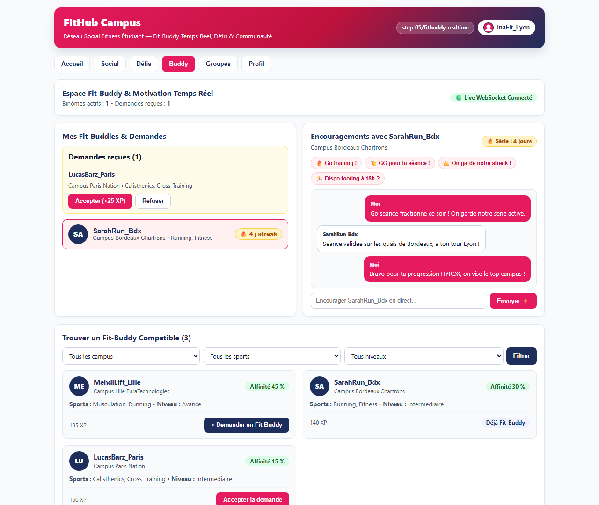
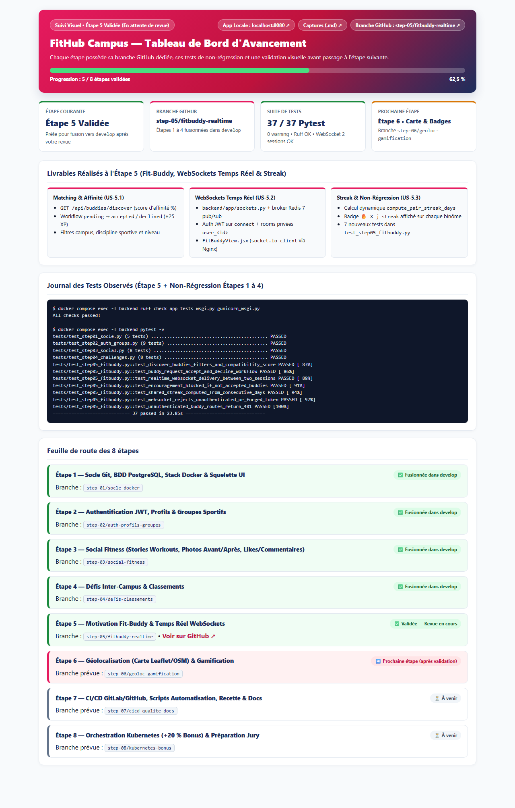
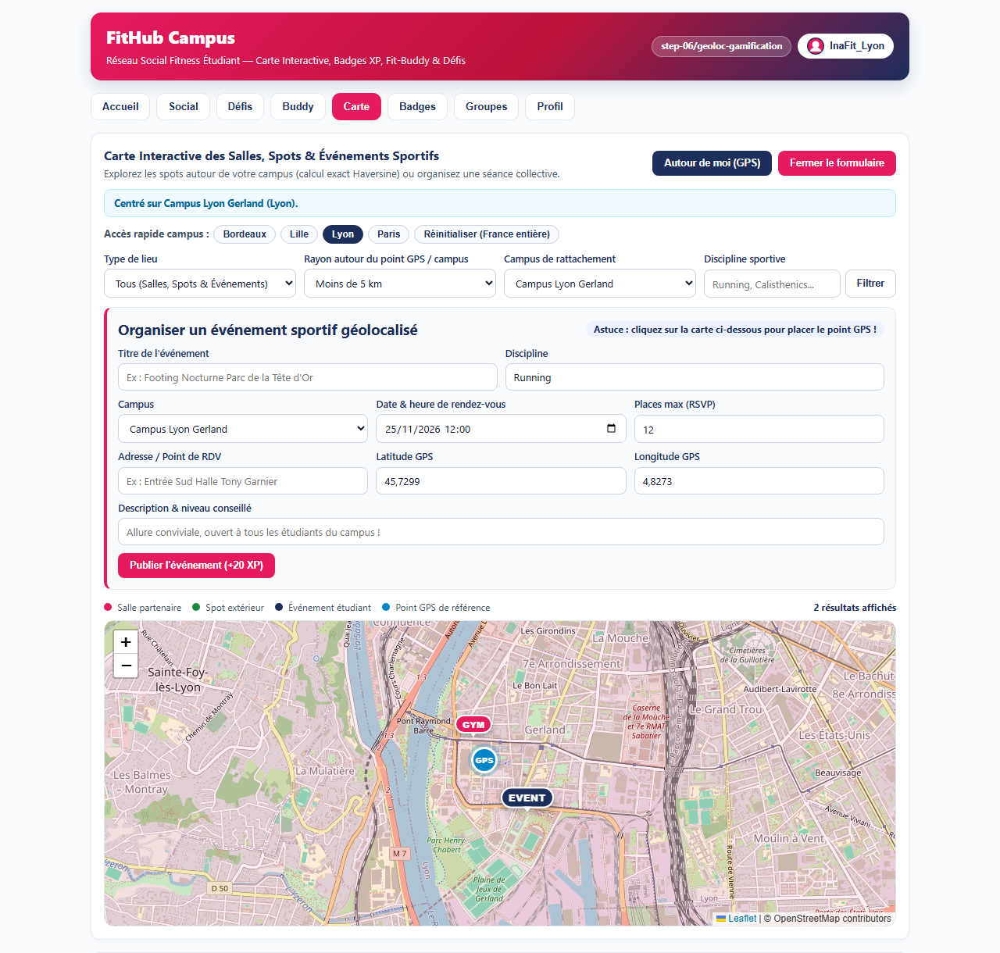

# FitHub Campus — Album des Captures d'Écran par Étape

Ce document conserve, **étape par étape**, les captures d'écran réelles validant chaque incrément du projet **FitHub Campus** avant le passage à l'étape suivante.

- **Dépôt GitHub** : https://github.com/frank-kenfack/FitHub-Campus
- **Journal d'avancement** : [AVANCEMENT.md](./AVANCEMENT.md)
- **Tableau de bord interactif** : [docs/SUIVI_ETAPES.html](./docs/SUIVI_ETAPES.html)
- **Règle de mise à jour** : à chaque nouvelle branche `step-XX/...`, les captures de l'étape sont enregistrées dans `docs/screenshots/step-XX/` et ajoutées dans ce fichier avant validation.

---

## Sommaire des Étapes

1. [Étape 1 — `step-01/socle-docker` (Socle Git, PostgreSQL, Stack Docker 4 conteneurs & UI Mobile-First)](#étape-1--step-01socle-docker) ✅
2. [Étape 2 — `step-02/auth-profils-groupes` (Authentification JWT, Profils & Groupes Sportifs)](#étape-2--step-02auth-profils-groupes) ✅
3. [Étape 3 — `step-03/social-fitness` (Stories Workouts, Photos Avant/Après & Interactions)](#étape-3--step-03social-fitness) ✅
4. [Étape 4 — `step-04/defis-classements` (Défis Inter-Campus & Leaderboards)](#étape-4--step-04defis-classements) ✅
5. [Étape 5 — `step-05/fitbuddy-realtime` (Matching Fit-Buddy & Temps Réel WebSockets)](#étape-5--step-05fitbuddy-realtime) ✅
6. [Étape 6 — `step-06/geoloc-gamification` (Carte Leaflet/OSM, Événements & Badges)](#étape-6--step-06geoloc-gamification) ⏳
7. [Étape 7 — `step-07/cicd-qualite-docs` (Pipelines CI/CD GitLab/GitHub, Scripts & Recette)](#étape-7--step-07cicd-qualite-docs) ⏳
8. [Étape 8 — `step-08/kubernetes-bonus` (Orchestration Kubernetes +20 % & Démo Jury)](#étape-8--step-08kubernetes-bonus) ⏳

---

## Étape 1 — `step-01/socle-docker`

- **Statut** : ✅ Validée par les tests (`ruff` OK • `pytest` 5/5 • 4 conteneurs `healthy` • persistance PostgreSQL vérifiée)
- **Branche GitHub** : [`step-01/socle-docker`](https://github.com/frank-kenfack/FitHub-Campus/tree/step-01/socle-docker)
- **Services actifs** : `fithub-frontend` (`:8080`), `fithub-backend` (`:5000`), `fithub-db` (PostgreSQL 16), `fithub-redis` (Redis 7)

### 1.1 Vue Desktop de l'application (`http://localhost:8080/`)
Affichage en direct de l'état de santé des conteneurs (`Opérationnel`, `PostgreSQL Connecté`, `Redis Connecté`), des compteurs seedés (`4 campus • 5 badges • 4 lieux`) et de la liste des campus étudiants chargés depuis PostgreSQL.

---

### 1.2 Vue Responsive Mobile-First (Navigation basse à 5 onglets)
Adaptation mobile avec empilement vertical des cartes et barre de navigation fixe en bas d'écran (`Accueil`, `Social`, `Défis`, `Fit-Buddy`, `Carte`).

---

### 1.3 Endpoint de santé `/api/health` servi via le reverse proxy Nginx
Vérification JSON directe prouvant la connectivité entre Nginx (`frontend`), Gunicorn/Flask (`backend`), PostgreSQL (`db`) et Redis (`redis`).

---

### 1.4 Tableau de bord d'avancement & Journal des tests (`docs/SUIVI_ETAPES.html`)
Synthèse visuelle de l'architecture à 4 conteneurs, des livrables et des résultats d'exécution de `docker compose ps`, `ruff` et `pytest`.

---

## Étape 2 — `step-02/auth-profils-groupes`

- **Statut** : ✅ Validée par les tests (`ruff` OK • `pytest` **14/14** sans warning • upload & persistance d'avatar sur `uploads_data` vérifiés après redémarrage conteneur)
- **Branche GitHub** : [`step-02/auth-profils-groupes`](https://github.com/frank-kenfack/FitHub-Campus/tree/step-02/auth-profils-groupes)
- **Fonctionnalités couvertes** : Inscription/Connexion JWT (`bcrypt`), édition de profil + statistiques personnelles, upload d'avatar redimensionné via Pillow et servi par Nginx, CRUD groupes sportifs + filtres + adhésion/désinscription + liste des membres.

### 2.1 Écran Connexion / Inscription JWT & Comptes de démonstration
Formulaire d'authentification étudiante (bascule Connexion / Inscription) accompagné des 3 comptes étudiants pré-seedés pour tester immédiatement les parcours.

---

### 2.2 Profil Sportif connecté (`InaFit_Lyon`) & Avatar persistant
Vue connectée affichant l'avatar stocké sur le volume persistant `/uploads/avatars/...`, les compteurs personnels (`220 Points XP`, `2 Groupes`, `Séances`, `Badges`) et le formulaire d'édition du profil.

---

### 2.3 Groupes Sportifs Inter-Campus, Filtres & Liste des Membres
Exploration des groupes par campus/discipline/mot-clé, boutons d'adhésion (`Rejoindre` / `Quitter`), contrôle créateur (`Suppr.`) et tiroir des membres déplié sur *Lyon Running Rhone*.

---

### 2.4 Tableau de bord d'avancement mis à jour (25 % — 14/14 Pytest)
Synthèse visuelle de l'Étape 2 validée et trace d'exécution des 14 tests automatisés (non-régression Étape 1 incluse).

---

## Étape 3 — `step-03/social-fitness`

- **Statut** : ✅ Validée par les tests (`ruff` OK • `pytest` **22/22** sans warning • médias `/uploads/stories/` persistés et servis en `200 OK` via Nginx)
- **Branche GitHub** : [`step-03/social-fitness`](https://github.com/frank-kenfack/FitHub-Campus/tree/step-03/social-fitness)
- **Fonctionnalités couvertes** : Stories de workouts (`< 24h` + métriques séance + `+25 XP`), comparatifs Avant/Après à double upload avec slider interactif et vue côte à côte (`+35 XP`), visibilité privée par groupe, likes idempotents, commentaires en direct et suppression réservée à l'auteur avec nettoyage disque.

### 3.1 Carrousel Stories &lt; 24h &amp; Comparateur interactif Avant / Après
Vue principale de l'onglet **Social** affichant les anneaux des stories récentes et le curseur glissant Avant/Après (`10 semaines`) avec applaudissements et commentaires.

---

### 3.2 Filtre « Stories &lt; 24h », Métriques de séance &amp; Contrôle auteur
Affichage filtré des séances des dernières 24h avec puces métriques (`Calisthenics`, `60 min`, `460 kcal`), compteur d'applaudissements et bouton `Suppr.` réservé à l'auteur.

---

### 3.3 Formulaire de publication d'une Story de Workout
Saisie complète d'une séance sportive (discipline, durée, distance, calories, visibilité publique ou groupe, upload photo validé par Pillow).

---

### 3.4 Tableau de bord d'avancement mis à jour (37,5 % — 22/22 Pytest)
Synthèse visuelle de l'Étape 3 validée et trace d'exécution des 22 tests automatisés (non-régression Étapes 1 et 2 incluse).

---

## Étape 4 — `step-04/defis-classements`

- **Statut** : ✅ Validée par les tests (`ruff` OK • `pytest` **30/30** sans warning • podiums des 4 campus et filtres actifs/terminés opérationnels)
- **Branche GitHub** : [`step-04/defis-classements`](https://github.com/frank-kenfack/FitHub-Campus/tree/step-04/defis-classements)
- **Fonctionnalités couvertes** : Création et inscription aux défis inter-campus avec anti-doublon (`409`), soumission transactionnelle de performances (avec validation stricte et preuve photo optionnelle), classements par défi et classement général (Top 3 podium des campus + rang personnel).

### 4.1 Podium du Défi Running Inter-Campus &amp; Jauges de progression
Affichage du Top 3 inter-campus (`🥇 Lyon`, `🥈 Lille`, `🥉 Bordeaux`), du classement complet des 4 écoles, du classement individuel (`Mon Campus : #1 • Mon Rang Personnel : #1`) et des cartes défis actifs.

---

### 4.2 Classement Général (XP Cumulés) &amp; Tiroir de soumission de performance
Bascule sur le **Podium Général Inter-Campus** en XP et ouverture du formulaire intégré **« + Performance »** (saisie chiffrée + preuve photo optionnelle).

---

### 4.3 Création d'un Défi Inter-Campus &amp; Filtre « Défis terminés »
Formulaire de création d'une nouvelle compétition inter-écoles et consultation de l'historique des défis clôturés (*Sprint Rentrée B3*).

---

### 4.4 Tableau de bord d'avancement mis à jour (50 % — 30/30 Pytest)
Synthèse visuelle du passage de mi-parcours (4 / 8 étapes validées) et trace d'exécution des 30 tests automatisés.

---

## Étape 5 — `step-05/fitbuddy-realtime`

- **Statut** : ✅ Fusionnée dans `develop` (`ruff` OK • `pytest` **37/37** sans warning • livraison WebSocket temps réel prouvée entre 2 sessions Chrome indépendantes via Nginx + Redis)
- **Branche GitHub** : [`step-05/fitbuddy-realtime`](https://github.com/frank-kenfack/FitHub-Campus/tree/step-05/fitbuddy-realtime)
- **Fonctionnalités couvertes** : Recherche et matching Fit-Buddy avec score d'affinité (`%`), workflow `pending` → `accepted` / `declined`, encouragements mutuels en temps réel via Flask-SocketIO + Redis + conservation en PostgreSQL, et compteur de régularité partagé (`🔥 streak`).

### 5.1 Espace Fit-Buddy, Demandes en attente, Streak &amp; Matching par affinité
Vue principale connectée (`🟢 Live WebSocket Connecté`) affichant la demande entrante de `LucasBarz_Paris`, le binôme actif `SarahRun_Bdx` (`🔥 4 j streak`) et les candidats triés par score d'affinité.

---

### 5.2 Session Navigateur B (`SarahRun_Bdx`) — Envoi d'un encouragement en 1 clic via WebSocket
Depuis une seconde session Chrome isolée, `SarahRun_Bdx` envoie l'encouragement rapide `🔥 Go training !` sur le canal Socket.IO.

---

### 5.3 Session Navigateur A (`InaFit_Lyon`) — Réception instantanée sans rechargement
La première session Chrome d'`InaFit_Lyon` (restée ouverte sans aucun `reload`) affiche immédiatement la notification verte temps réel `⚡ Encouragement reçu en direct de SarahRun_Bdx` et la nouvelle bulle dans la discussion.

---

### 5.4 Tableau de bord d'avancement mis à jour (62,5 % — 37/37 Pytest)
Synthèse visuelle de l'Étape 5 validée et trace d'exécution des 37 tests automatisés.

---

## Étape 6 — `step-06/geoloc-gamification`

- **Statut** : ✅ Validée par les tests (`ruff` OK • `pytest` **45/45** sans warning • Carte Leaflet/OpenStreetMap, rayon Haversine, capacité RSVP et connecteur Google Fit / GPX vérifiés)
- **Branche GitHub** : [`step-06/geoloc-gamification`](https://github.com/frank-kenfack/FitHub-Campus/tree/step-06/geoloc-gamification)
- **Fonctionnalités couvertes** : Carte interactive **Leaflet + OpenStreetMap** des salles partenaires, spots street-workout et événements étudiants, filtrage par rayon kilométrique exact (Haversine) avec repli GPS campus, création d'événements géolocalisés et gestion de capacité RSVP, déblocage automatique des 5 badges, paliers de récompenses XP et import d'activités externes (**Google Fit JSON** & traces **GPX**).

### 6.1 Carte Interactive Leaflet / OpenStreetMap, Cercle Haversine (5 km) &amp; Popup Événement
Vue centrée sur le campus de Lyon Gerland avec le rayon de recherche Haversine (`5 km`), les marqueurs personnalisés (`GYM`, `EVENT`, `GPS`), la popup interactive d'un événement local et les cartes de proximité triées par distance.

---

### 6.2 Création d'un Événement Sportif Géolocalisé &amp; Inscriptions RSVP
Ouverture du formulaire d'organisation d'événement géolocalisé (sélectionnable directement par clic sur la carte Leaflet) et affichage des compteurs de places disponibles (`1 / 12` inscrit).

---

### 6.3 Paliers de Récompenses XP, Synchronisation Google Fit / GPX &amp; Vitrine des 5 Badges
Synchronisation en 1 clic d'une course **Google Fit** (`8,6 km` crédités automatiquement sur le défi inter-campus actif + `+30 XP`), progression sur l'échelle des récompenses (*Athlète Or*) et vitrine des badges d'accomplissement débloqués.

---

### 6.4 Tableau de bord d'avancement mis à jour (75 % — 45/45 Pytest)
Synthèse visuelle de l'achèvement fonctionnel du MVP (6 / 8 étapes validées) et journal complet des 45 tests automatisés.

---

## Étape 7 — `step-07/cicd-qualite-docs`

> ⏳ *Captures à ajouter lors de la réalisation de l'Étape 7 dans `docs/screenshots/step-07/` (exécution des pipelines CI/CD, rapport de tests E2E et benchmark de performance `< 300 ms`).*

---

## Étape 8 — `step-08/kubernetes-bonus`

> ⏳ *Captures à ajouter lors de la réalisation de l'Étape 8 dans `docs/screenshots/step-08/` (état des pods/services/PVC/Ingress Kubernetes pour le bonus +20 % et parcours final de démo jury).*
