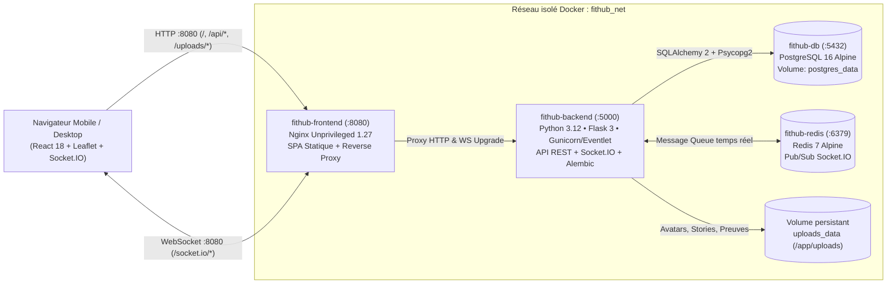

# FitHub Campus — Réseau Social Fitness Étudiant (MVP Cloud-Native & DevOps)

Plateforme web *mobile-first* destinée aux étudiants d'enseignement supérieur pour fédérer l'entraide sportive sur les campus : groupes par discipline, stories workouts & comparatifs Avant/Après, défis inter-campus avec podiums temps réel, matching **Fit-Buddy** par affinité + encouragements **WebSockets**, carte interactive **Leaflet / OpenStreetMap** avec filtrage **Haversine**, badges automatiques et connecteur **Google Fit / GPX**.

---

## Sommaire

1. [Architecture Cloud-Native (4 Conteneurs Docker)](#1-architecture-cloud-native-4-conteneurs-docker)
2. [Fonctionnalités du MVP](#2-fonctionnalités-du-mvp)
3. [Démarrage Rapide (1 commande)](#3-démarrage-rapide-1-commande)
4. [Comptes Étudiants de Démonstration](#4-comptes-étudiants-de-démonstration)
5. [Référence des Endpoints API REST & WebSocket](#5-référence-des-endpoints-api-rest--websocket)
6. [Qualité, Tests Automatisés & Performance (< 300 ms)](#6-qualité-tests-automatisés--performance--300-ms)
7. [Pipelines CI/CD & Automatisation DevOps (GitLab, GitHub Actions, Ansible)](#7-pipelines-cicd--automatisation-devops-gitlab-github-actions-ansible)
8. [Sécurité Applicative & Conteneurs](#8-sécurité-applicative--conteneurs)
9. [Documentation Complémentaire & Suivi Visuel](#9-documentation-complémentaire--suivi-visuel)

---

## 1. Architecture Cloud-Native (4 Conteneurs Docker)



| Conteneur | Image / Build Multi-Stage | Rôle | Exposition |
| :--- | :--- | :--- | :--- |
| **`fithub-frontend`** | `node:20-alpine` → `nginxinc/nginx-unprivileged:1.27-alpine` | Bundle React 18 / Vite + Reverse Proxy HTTP & WebSocket | `8080` (hôte) |
| **`fithub-backend`** | `python:3.12-slim` (multi-stage, utilisateur non-root `appuser`) | API REST Flask, migrations Alembic auto, Socket.IO Eventlet | `5000` |
| **`fithub-db`** | `postgres:16-alpine` | Base relationnelle 16 tables métier (`postgres_data`) | Interne `fithub_net` |
| **`fithub-redis`** | `redis:7-alpine` | Broker de messages pub/sub Socket.IO inter-workers | Interne `fithub_net` |

---

## 2. Fonctionnalités du MVP

- **Authentification JWT & Profils (`EP-02`)** : Inscription/connexion (`bcrypt` + JWT RFC 7518), édition du profil sportif, upload d'avatar validé/redimensionné par Pillow sur volume persistant, création et adhésion aux groupes sportifs par campus.
- **Social Fitness (`EP-03`)** : Carrousel de stories workouts fraîches (`< 24h`), comparateur interactif Avant/Après (curseur coulissant `clip-path` + mode côte à côte), contrôle de visibilité privé groupe, likes idempotents et commentaires.
- **Défis Inter-Campus & Classements (`EP-04`)** : Compétitions actives/terminées, inscription anti-doublon rattachée au campus, soumission transactionnelle (`SELECT ... FOR UPDATE`) de scores avec preuve photo optionnelle, podiums Top 3 inter-campus et individuels.
- **Fit-Buddy & Temps Réel (`EP-05`)** : Algorithme de matching par score d'affinité (`%`), cycle `pending` → `accepted` / `declined`, encouragements instantanés bidirectionnels via **Flask-SocketIO + Redis** et calcul dynamique du `streak` partagé.
- **Géolocalisation Leaflet & Haversine (`EP-06`)** : Carte interactive **Leaflet + OpenStreetMap**, géolocalisation HTML5 avec repli automatique sur les coordonnées GPS du campus, filtrage orthodromique exact **Haversine** par rayon kilométrique, création d'événements géolocalisés et gestion de capacité RSVP (`409 Conflict` si complet).
- **Gamification & Connecteur Externe (`EP-07`)** : Attribution automatique sans doublon de 5 badges, échelle de 4 paliers de récompenses virtuelles XP et import d'activités **Google Fit REST JSON** ou traces GPS **`.gpx` / `.json`** créditant automatiquement les défis actifs.

---

## 3. Démarrage Rapide (1 commande)

### Prérequis
- **Docker Engine** `>= 24.0` et **Docker Compose v2** (`docker compose version`)

### Lancement standard
```bash
cp .env.example .env
docker compose up --build -d --wait
```

Ou via le script d'automatisation DevOps (vérifie `.env`, construit, attend les *healthchecks* et exécute un *smoke test* `< 300 ms`) :
```bash
chmod +x scripts/deploy.sh
./scripts/deploy.sh
```

### Accès locaux
- **Application Web complète** : http://localhost:8080
- **Santé globale API + PostgreSQL + Redis** : http://localhost:8080/api/health
- **Santé Reverse Proxy Nginx** : http://localhost:8080/nginx-health

---

## 4. Comptes Étudiants de Démonstration

Au premier démarrage, `backend/app/seed.py` initialise de manière **idempotente** 4 campus, 5 badges, 4 salles/spots partenaires, 4 étudiants, 3 groupes, 3 stories, 3 défis et 1 binôme Fit-Buddy actif.  
Tous les comptes de démo sont accessibles en **1 clic** depuis l'onglet **Profil** (mot de passe commun : `Password123!`) :

| Étudiant | Email | Campus | Spécialités |
| :--- | :--- | :--- | :--- |
| **InaFit_Lyon** | `ina.lyon@fithub.fr` | Campus Lyon Gerland | Running, Renforcement |
| **LucasBarz_Paris** | `lucas.paris@fithub.fr` | Campus Paris Nation | Calisthenics, Cross-Training |
| **SarahRun_Bdx** | `sarah.bordeaux@fithub.fr` | Campus Bordeaux Chartrons | Running, Fitness |
| **MehdiLift_Lille** | `mehdi.lille@fithub.fr` | Campus Lille EuraTechnologies | Musculation, Running |

---

## 5. Référence des Endpoints API REST & WebSocket

| Domaine | Méthode & Route | Auth | Description |
| :--- | :--- | :---: | :--- |
| **Santé** | `GET /api/health`, `GET /api/campuses` | Public | Santé BDD/Redis, statistiques globales et campus GPS |
| **Auth** | `POST /api/auth/register`, `POST /api/auth/login`, `GET /api/auth/me` | Public / JWT | Création compte (`bcrypt`), émission et vérification JWT |
| **Profil** | `GET/PUT /api/users/me`, `POST /api/users/me/avatar` | JWT | Statistiques XP/badges, mise à jour profil, upload avatar PNG |
| **Groupes** | `GET/POST /api/groups`, `GET/PUT/DELETE /api/groups/<id>`, `POST join/leave` | Public / JWT | CRUD groupes sportifs, filtres campus/sport, adhésion |
| **Social** | `GET /api/social/posts`, `POST stories`, `POST before-after`, `POST like`, `comments` | Public / JWT | Stories 24h, comparatifs Avant/Après, likes idempotents, commentaires |
| **Défis** | `GET/POST /api/challenges`, `POST join`, `POST performances`, `GET leaderboard` | Public / JWT | Défis inter-campus, saisie performances + preuves, podiums Top 3 |
| **Buddy** | `GET /api/buddies`, `GET discover`, `POST request`, `POST respond`, `encouragements` | JWT | Matching affinité `%`, gestion duos, historique encouragements |
| **Temps réel** | WebSocket `/socket.io` (`connect`, `send_encouragement` → `new_encouragement`) | JWT | Diffusion instantanée via rooms `user_<id>` et broker Redis |
| **Carte** | `GET /api/places`, `POST /api/places/events`, `POST rsvp`, `DELETE <id>` | Public / JWT | Filtre rayon Haversine, création événements GPS, capacité RSVP |
| **Badges** | `GET /api/gamification/summary`, `POST /api/gamification/import-activity` | JWT | Badges auto, paliers XP, connecteur Google Fit JSON & GPX XML |

---

## 6. Qualité, Tests Automatisés & Performance (`< 300 ms`)

La suite de **51 tests automatisés Pytest** couvre les 7 étapes (intégrité des 16 tables PostgreSQL, authentification `bcrypt`/JWT, uploads médias, visibilité sociale, calculs transactionnels des défis, livraison temps réel entre 2 sessions Socket.IO, filtrage Haversine, capacité RSVP, import GPX anti-XXE, résistance aux injections SQL et temps de réponse `< 300 ms` sur tous les endpoints critiques) :

```bash
# Exécuter toute la chaîne qualité (Ruff + 51 tests Pytest + Smoke test latence < 300 ms)
chmod +x scripts/run_tests.sh
./scripts/run_tests.sh

# Ou directement dans le conteneur backend :
docker compose exec -T backend ruff check app tests wsgi.py gunicorn_wsgi.py
docker compose exec -T backend pytest -v
```

---

## 7. Pipelines CI/CD & Automatisation DevOps (GitLab, GitHub Actions, Ansible)

- **GitLab CI (`.gitlab-ci.yml`)** : Pipeline structuré en 4 stages (`lint` → `test` → `build` → `deploy`) avec services `postgres:16-alpine` et `redis:7-alpine`, rapport JUnit XML, build d'images Docker taguées `$CI_COMMIT_SHORT_SHA` et déploiement Ansible vers `staging` (auto sur `develop`) et `production` (validation manuelle sur `main`).
- **GitHub Actions (`.github/workflows/ci.yml`)** : Exécution automatique à chaque `push` / `pull_request` de 3 jobs chaînés :
  1. `lint-and-frontend` (`ruff check` + build de production `vite build`),
  2. `pytest-integration` (migrations Alembic + 51 tests `pytest` face à PostgreSQL 16 & Redis 7),
  3. `docker-compose-smoke` (`docker compose up --build -d --wait` + `scripts/smoke_test.sh` vérifiant HTTP 200 et `< 300 ms` via Nginx).
- **Playbook Ansible (`infra/ansible/deploy.yml`)** : Provisionnement idempotent d'un serveur Ubuntu/Debian, déploiement Docker Compose et contrôle de santé automatique sur `/api/health`.

---

## 8. Sécurité Applicative & Conteneurs

- **Mots de passe & Jetons** : Hachage `bcrypt` salé, clés HMAC JWT conformes à la RFC 7518 (`>= 256 bits`), authentification stricte sur la poignée de main WebSocket Socket.IO.
- **Moindre privilège Docker** : Image frontend basée sur `nginxinc/nginx-unprivileged` (port `8080`, UID `101`) et image backend exécutée sous l'utilisateur système non-root `appuser`.
- **Validation des entrées & médias** : Décodage/vérification réelle des images via Pillow (rejet de tout binaire déguisé, reconversion PNG propre, limite `10 Mo`), blocage explicite des entités XML externes (`<!DOCTYPE` / `<!ENTITY`) lors de l'import GPX, et requêtes SQL 100 % paramétrées via SQLAlchemy ORM.
- **Gestion des secrets** : Aucun secret ni jeton commité dans Git (`.env` ignoré, modèle `.env.example` fourni).

---

## 9. Documentation Complémentaire & Suivi Visuel

- Architecture détaillée & MCD : [docs/ARCHITECTURE_TECHNIQUE.md](./docs/ARCHITECTURE_TECHNIQUE.md)
- Backlog MVP découpé (9 Epics, 30 US) : [FitHub_Campus_Backlog_MVP.pdf](./FitHub_Campus_Backlog_MVP.pdf)
- Album des captures par étape : [CAPTURES_ETAPES.md](./CAPTURES_ETAPES.md)
- Tableau de bord interactif d'avancement : [docs/SUIVI_ETAPES.html](./docs/SUIVI_ETAPES.html)
- Journal d'avancement : [AVANCEMENT.md](./AVANCEMENT.md)
