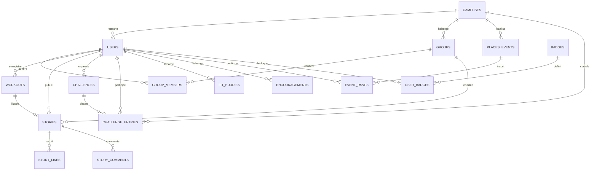
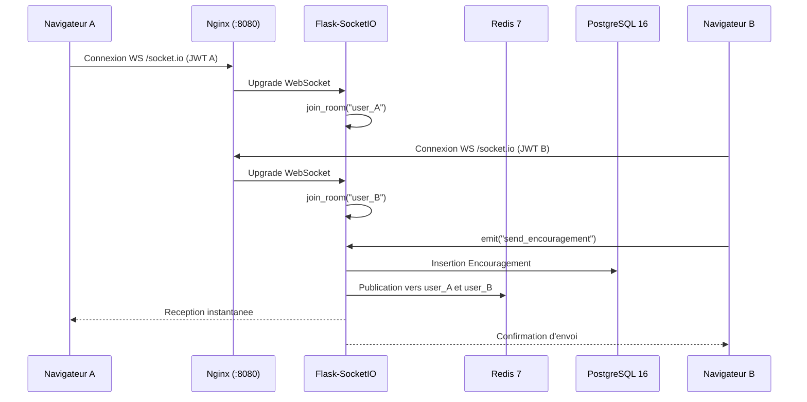

# FITHUB CAMPUS : ARCHITECTURE TECHNIQUE ET CHAÎNE DEVOPS

Ce document présente l'organisation des services applicatifs, le schéma relationnel PostgreSQL à 16 tables, le fonctionnement de la messagerie temps réel et l'automatisation des déploiements.

## 1. ORGANISATION RÉSEAU DES CONTENEURS

Les quatre services communiquent au sein du réseau Docker isolé `fithub_net`, avec le proxy Nginx exposé sur le port `8080` :

1. Le serveur Nginx distribue le bundle React statique sur `/`.
2. Les appels `/api/*` sont relayés vers Gunicorn et Flask sur le port interne `5000`.
3. Le canal `/socket.io/*` active la mise à niveau WebSocket vers Flask-SocketIO.
4. Les médias déposés par les étudiants sont lus depuis le volume nommé `uploads_data` sous `/uploads/*`.

## 2. MODÈLE RELATIONNEL POSTGRESQL (16 TABLES)

Le schéma est géré par Alembic dans `backend/migrations/versions/b7ed6f971fa6_initial_schema.py`.

### Contraintes d'unicité en base

La contrainte `uq_group_member` empêche toute double adhésion à un club sportif, et `uq_story_like` garantit l'idempotence des mentions j'aime. Sur les défis et événements, `uq_challenge_entry` et `uq_event_rsvp` (complétés par un verrou `SELECT ... FOR UPDATE`) empêchent les inscriptions multiples et le dépassement de capacité. Les attributions de trophées sont protégées par `uq_user_badge`.

## 3. MESSAGERIE TEMPS RÉEL SOCKET.IO ET REDIS

Le branchement de `message_queue=REDIS_URL` permet aux deux réplicas du serveur backend prévus sous Kubernetes de diffuser les événements Socket.IO entre pods distincts.

## 4. RÈGLES MÉTIER PRINCIPALES

Dans `backend/app/services/badge_progression.py`, le calcul Haversine utilise le rayon terrestre moyen (`6371,0088 km`) à la fois pour filtrer les lieux par périmètre sur `GET /api/places` et pour mesurer la distance d'une trace XML `.gpx`. L'attribution des badges additionne ensuite les récompenses acquises à l'expérience des séances sans jamais créer de doublon.

## 5. CHAÎNE D'INTÉGRATION ET DE DÉPLOIEMENT

La chaîne s'appuie sur `.gitlab-ci.yml`, `.github/workflows/ci.yml` et `infra/ansible/deploy.yml` : analyse statique `ruff`, build de l'interface React, tests Pytest face à PostgreSQL 16 et Redis 7, contrôle de latence sous 300 ms par `scripts/smoke_test.sh`, puis déploiement Ansible et validation Kustomize dans `k8s/`.
