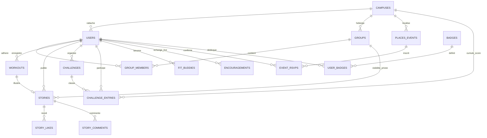
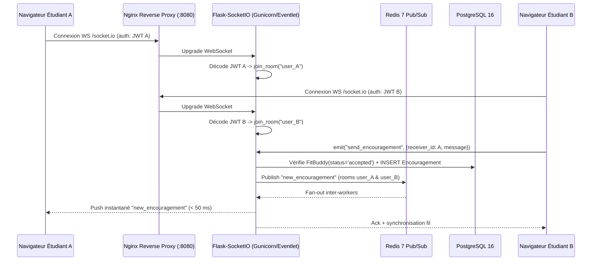
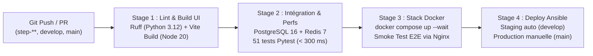

# FitHub Campus — Architecture Technique, MCD & Chaine DevOps

Ce document détaille les choix d'architecture logicielle, le schéma relationnel PostgreSQL (16 tables), les flux temps réel WebSocket/Redis et l'industrialisation CI/CD de **FitHub Campus**.

---

## 1. Vue d'Ensemble Système & Flux Réseau

L'ensemble de la pile applicative s'exécute au sein d'un réseau privé Docker (`fithub_net`). Seul le reverse proxy **Nginx Unprivileged (`:8080`)** est requis en frontal utilisateur :

- **`/`** : Distribution statique haute performance du bundle **React 18 + Vite** (SPA avec repli `try_files $uri /index.html`).
- **`/api/*`** : Proxy HTTP vers **Gunicorn + Eventlet (`backend:5000`)** avec propagation des en-têtes `X-Real-IP` et `X-Forwarded-For`.
- **`/socket.io/*`** : Proxy HTTP/1.1 avec mise à niveau protocolaire (`Upgrade: websocket`, `Connection: upgrade`) permettant les canaux persistants bidirectionnels **Flask-SocketIO**.
- **`/uploads/*`** : Distribution des médias validés (avatars, stories, comparatifs Avant/Après, preuves de défis) stockés sur le volume nommé **`uploads_data`**.

---

## 2. Modèle Conceptuel & Relationnel PostgreSQL 16 (16 Tables)

Le schéma est intégralement géré par **Alembic / Flask-Migrate** (`backend/migrations/versions/b7ed6f971fa6_initial_schema.py`) avec contraintes d'intégrité référentielle (`FOREIGN KEY ... ON DELETE CASCADE / RESTRICT / SET NULL`) et contraintes d'unicité métier :

### Contraintes d'unicité critiques garanties en base
- `uq_group_member (group_id, user_id)` : empêche toute double adhésion à un groupe sportif.
- `uq_story_like (story_id, user_id)` : garantit l'idempotence stricte des likes sociaux.
- `uq_challenge_entry (challenge_id, user_id)` : empêche la double inscription d'un étudiant à un défi.
- `uq_fit_buddy_pair (requester_id, addressee_id)` : unicité du lien de binôme.
- `uq_event_rsvp (event_id, user_id)` + verrouillage `SELECT ... FOR UPDATE` sur `places_events` : empêche tout dépassement concurrent de `max_participants`.
- `uq_user_badge (user_id, badge_id)` : garantit qu'un badge ne peut jamais être attribué deux fois.

---

## 3. Architecture Temps Réel (Flask-SocketIO + Redis 7)

En utilisant `message_queue=REDIS_URL`, l'architecture est nativement prête pour un **passage à l'échelle horizontal** (plusieurs réplicas backend derrière un Service Kubernetes `ClusterIP`, implémenté à l'Étape 8) : même si l'Étudiant A et l'Étudiant B sont connectés sur deux pods backend distincts, Redis propage l'événement Socket.IO à tous les réplicas.

---

## 4. Algorithmes Métier Clés

1. **Filtrage Géographique Haversine (`backend/app/utils/gamification.py`)** :
   Calcul exact de la distance orthodromique sur la sphère terrestre ($R = 6371{,}0088\text{ km}$) tant pour filtrer les salles/événements autour de l'étudiant (`GET /api/places?lat=...&lon=...&radius_km=...`) que pour calculer le kilométrage réel d'une trace XML `.gpx` à partir de sa séquence de points `<trkpt>`.
2. **Matching d'Affinité Fit-Buddy (`backend/app/routes/buddies.py`)** :
   Score pondéré sur `100 %` combinant proximité de campus (`+35 %`), disciplines sportives communes (`+45 %`) et proximité de niveau sportif (`+20 %`).
3. **Moteur de Gamification Idempotent (`evaluate_and_award_badges`)** :
   Séparation nette entre l'`activity_xp` (points gagnés par action) et le `badges_xp` (somme déterministe des `xp_reward` des badges acquis), évitant tout risque d'inflation lors de synchronisations répétées.

---

## 5. Chaîne CI/CD & Déploiement Continu

- **Exécution locale** : `./scripts/deploy.sh` et `./scripts/run_tests.sh`.
- **Intégration Continue Cloud** : `.github/workflows/ci.yml` (GitHub Actions) et `.gitlab-ci.yml` (GitLab CI).
- **Gestion de configuration** : `infra/ansible/deploy.yml` (déploiement reproductible sans intervention manuelle).
